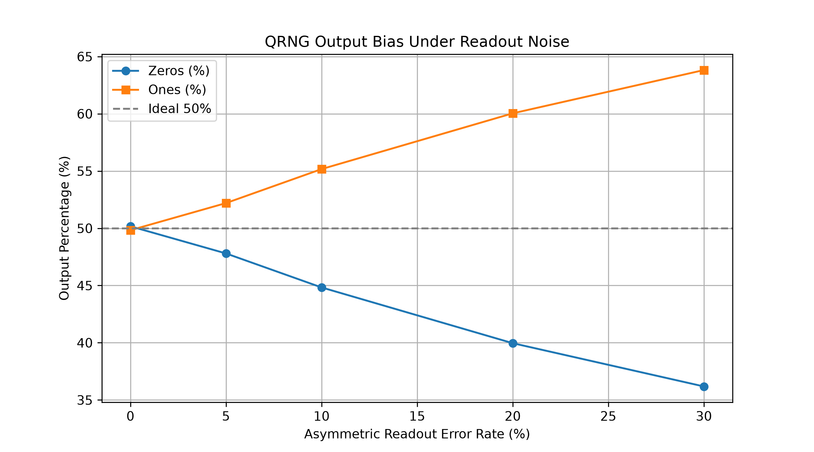
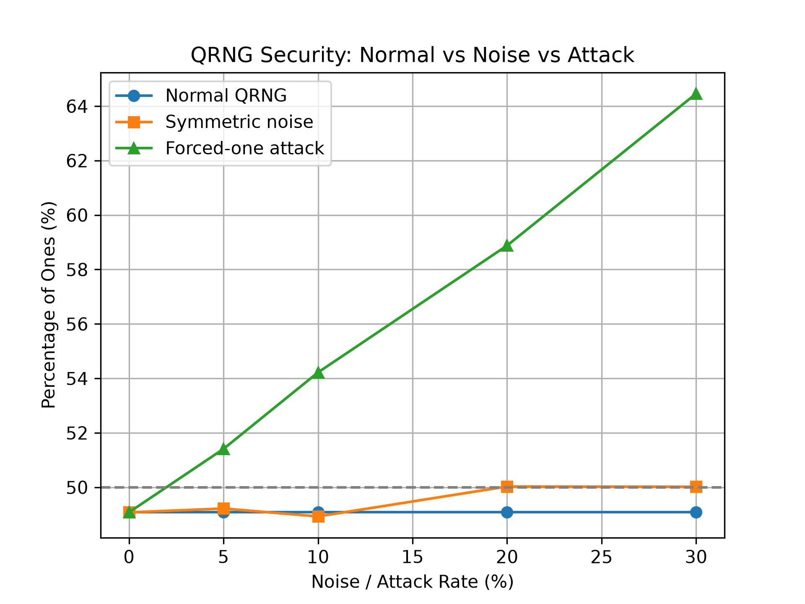
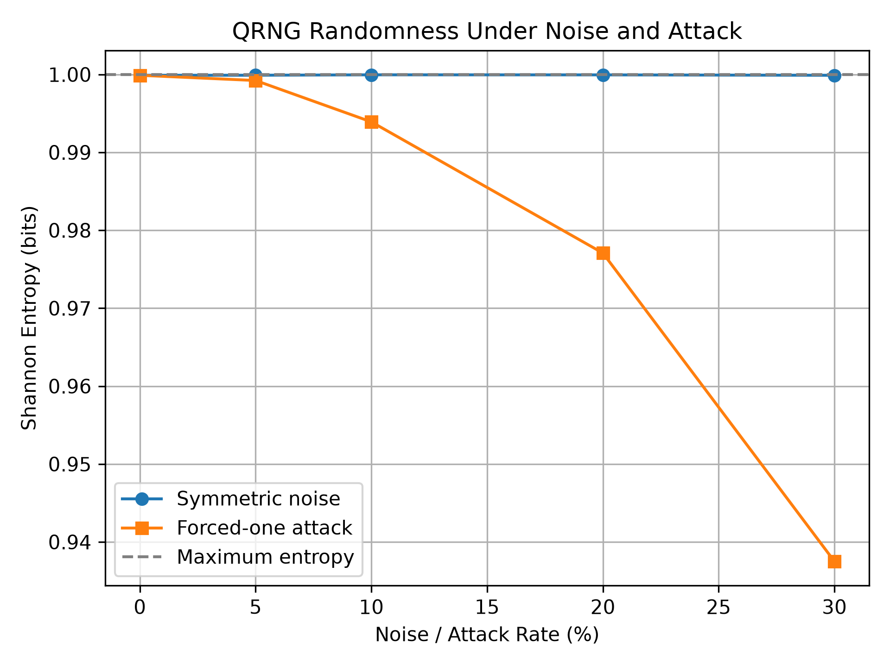
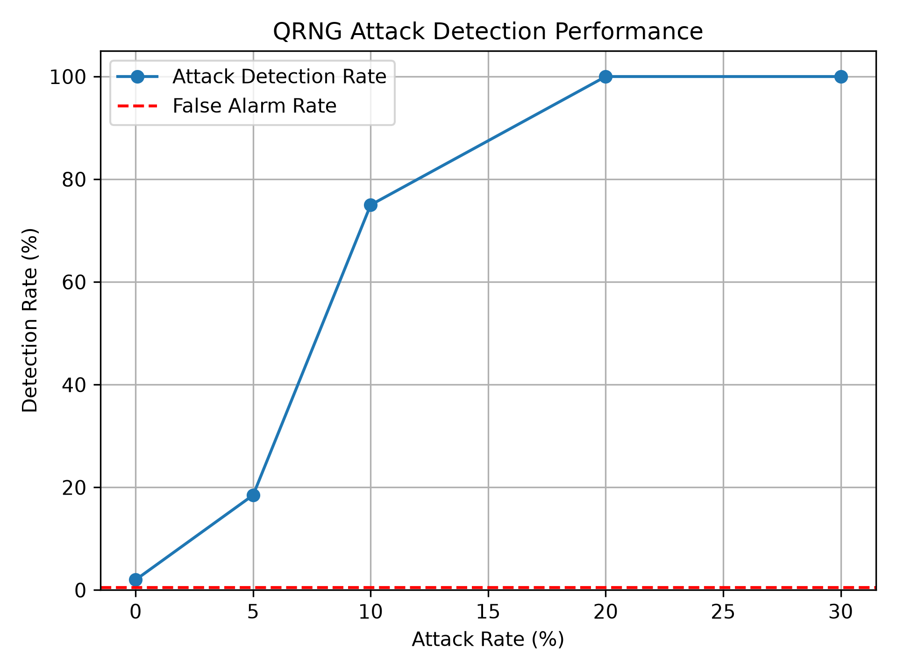
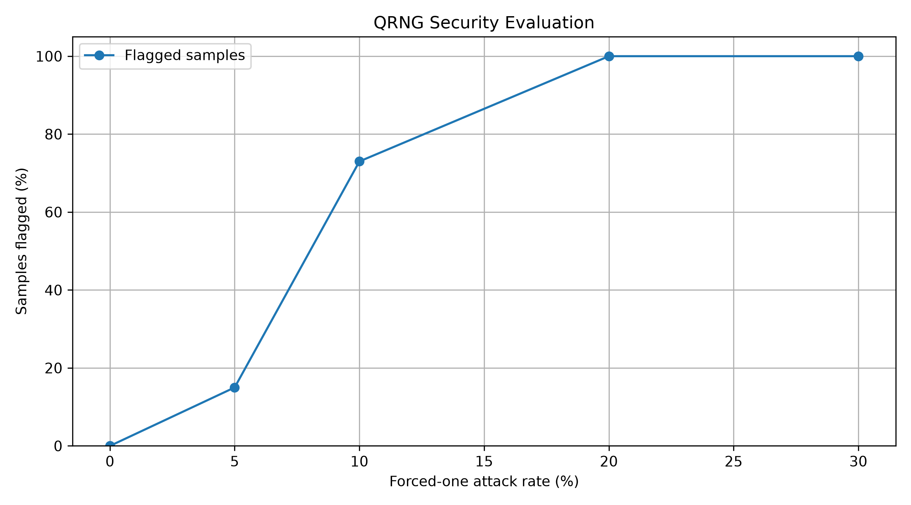

# Quantum Random Number Generation — Security Analysis

## Overview
This project explores the security and reliability of quantum random number generation (QRNG) through Python and Qiskit simulations. It examines baseline random-bit generation, simulated noise, attack conditions, randomness evaluation, and detection approaches.

## Objectives
- Implement a baseline QRNG simulation.
- Investigate the effects of noise on generated bit sequences.
- Simulate attack conditions and compare outputs.
- Evaluate randomness and entropy-related behavior.
- Explore statistical approaches for detecting abnormal behavior.

## Technologies
- Python
- Qiskit
- Quantum circuit simulation
- Statistical analysis and data visualization

## Project Files
| File | Purpose |
| --- | --- |
| `qrng_baseline.py` | Baseline QRNG simulation |
| `qrng_noise.py` | Noise simulation |
| `qrng_attack.py` | Attack-condition simulation |
| `qrng_attack_detection.py` | Attack detection analysis |
| `qrng_randomness_tests.py` | Randomness evaluation |
| `qrng_final_evaluation.py` | Final evaluation |
| `qrng_graph.py` | Graph generation |

## Experimental Visualizations

### Noise comparison

### Attack comparison

### Entropy comparison

### Detection results

### Final evaluation

## Scope and Limitations
This is an academic simulation-based cybersecurity project. The results should not be interpreted as certification of a hardware QRNG, proof of cryptographic security, or evidence of experiments on physical quantum hardware.

## Future Work
- Investigate additional noise models and attack scenarios.
- Improve statistical evaluation and reproducibility.
- Explore connections with quantum memory and hardware security research.

## Author
Kalyan Raju  
Doctor of Engineering Student, Electrical Engineering  
Lamar University

[LinkedIn](https://www.linkedin.com/in/kalyan-raju-7437132b1)
